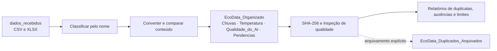

# EcoData — Ciência de Dados e Engenharia de Soluções com Python e IA

O EcoData organiza arquivos ambientais CSV e XLSX, preserva as entradas e produz relatórios de duplicidade e qualidade dos dados. O projeto usa Python, Pandas e Jupyter Notebook para simular o trabalho de uma organização de monitoramento ambiental. Seu desenvolvimento combinou requisitos e validação conduzidos pelo autor com implementação assistida por ChatGPT e OpenAI Codex.

> **Dados fictícios.** As medições e os arquivos usados no desenvolvimento são material de aprendizado e simulação; não representam dados ambientais oficiais. Os diretórios de dados locais não são distribuídos neste repositório.

## Problema e solução

Na organização fictícia EcoData, estações e equipes entregam medições de precipitação, temperatura, umidade e qualidade do ar. Os arquivos chegam em formatos distintos, podem ter nomes ambíguos, conteúdos repetidos, campos ausentes ou valores inconsistentes. Uma ingestão baseada apenas no nome do arquivo poderia perder uma versão diferente ou recriar uma duplicata já arquivada.

O fluxo separa recebimento, classificação, conversão, organização e análise. Conflitos são informados e o conteúdo divergente recebe um nome alternativo, sem sobrescrever o destino existente. A deduplicação efetiva exige uma chamada explícita; os relatórios de qualidade mostram problemas, sem corrigir medições automaticamente.



## Método de Engenharia de Soluções

O trabalho seguiu a sequência **compreender o problema → definir requisitos → planejar → implementar → revisar criticamente → testar → corrigir → validar**. Primeiro foram definidos entradas, categorias, regras ambientais e critérios de preservação. Depois, o fluxo foi dividido em funções com responsabilidades específicas. Cada revisão examinou cenários de falha, como colisões de nomes, arquivos ilegíveis e reexecuções; os resultados observados orientaram as correções.

O código foi desenvolvido com **ChatGPT e OpenAI Codex**. O autor dirigiu a definição do problema, o planejamento, as restrições, os prompts técnicos, os critérios de teste, a análise dos resultados e as decisões de evolução. As ferramentas de IA apoiaram a implementação em Python, a depuração, os testes e a documentação. Essa divisão torna explícita a responsabilidade humana pela direção e avaliação da solução, sem atribuir ao autor escrita manual de código que não foi documentada.

## Como funciona

O [notebook principal](Automacao_Ecodata_RV01_RV02_validado_20261024_96ae10bd047d.ipynb) organiza o fluxo em células procedurais, com a chamada de cada operação logo após sua definição.

| Etapa | Funções | Comportamento |
|---|---|---|
| Descoberta | `listar_arquivos()` | Localiza arquivos CSV e XLSX diretamente em `dados_recebidos/`. |
| Classificação | `identificar_categoria()` | Usa palavras completas no nome para escolher Chuvas, Temperatura ou Qualidade_do_Ar; nomes sem pista suficiente ou ambíguos vão para Pendencias. |
| Conversão | `converter_para_csv()` | Lê CSV ou a primeira planilha XLSX com Pandas e gera CSV UTF-8-SIG; trata `id_registro` e `estacao_id` como texto e sinaliza representações Excel ambíguas. |
| Organização | `organizar_arquivos()` | Prepara um CSV temporário, compara campos e publica sem sobrescrever. Reconhece cópias ativas, conteúdos arquivados e conflitos; conteúdos divergentes recebem nomes alternativos. |
| Duplicatas exatas | `calcular_hash()`, `verificar_arquivos_duplicados()` | Calcula SHA-256 dos bytes dos CSVs ativos e relaciona arquivos binariamente idênticos, mesmo com nomes diferentes. |
| Tratamento controlado | `remover_arquivos_duplicados()` | Simula por padrão (`executar=False`). Com `executar=True`, arquiva a redundância; se já houver backup idêntico confirmado, elimina somente a cópia ativa redundante. |
| Qualidade inicial | `verificar_qualidade()` | Relata arquivo, categoria, linhas, colunas, valores ausentes e linhas internamente repetidas. |
| Ausências | `detalhar_ausentes()` | Aponta colunas e registros afetados. Erros de leitura são mostrados e os demais arquivos continuam sendo analisados. |
| Regras ambientais | `validar_valores()` | Informa medições fora dos limites e valores não numéricos. Usa o índice do DataFrame quando `id_registro` está ausente ou vazio. |

A comparação durante a **ingestão** usa uma assinatura dos campos CSV, normalizando diferenças de quebra de linha sem apagar diferenças textuais, de ordem ou de identificadores. A **verificação de duplicatas** usa o SHA-256 binário dos arquivos organizados. Esses critérios têm propósitos distintos: nenhum deles detecta, por si só, registros parcialmente repetidos entre arquivos.

As regras de `validar_valores()` são precipitação e PM2,5/PM10 **não negativos** e umidade relativa **entre 0% e 100%**. Valores ausentes são investigados separadamente; `Pendencias` não recebe essas regras ambientais. Um arquivo não lido é reportado como falha de leitura, nunca como validado.

### Organização automática

O [monitor de ingestão](monitorar_ingestao.py) acompanha `dados_recebidos/` enquanto seu processo estiver aberto. Após observar o mesmo estado da entrada em duas verificações consecutivas, carrega somente as funções de ingestão do notebook final e chama `organizar_arquivos()`. Ele não executa todas as células nem arquiva duplicatas automaticamente. Para cópias grandes, finalize a transferência com extensão `.tmp` e renomeie para `.csv` ou `.xlsx` quando estiver completa.

## Tecnologias e revisão

| Recurso | Uso no projeto |
|---|---|
| Python e `pathlib` | Fluxo procedural, caminhos e arquivos. |
| Pandas e openpyxl | Leitura tabular de CSV/XLSX e conversão para CSV. |
| `hashlib`, `csv`, `tempfile` e `shutil` | Assinaturas, comparação, preparação temporária e arquivamento controlado. |
| Jupyter Notebook | Execução por etapas, explicações e saídas históricas. |
| Git | Registro local das etapas e recuperação de versões anteriores. |
| ChatGPT, Codex e Agent Skills | Apoio à implementação e revisão sob requisitos e validação dirigidos pelo autor. |

Uma **Agent Skill** é um procedimento reutilizável descrito em instruções estruturadas, geralmente em um arquivo `SKILL.md`. O autor criou a skill local `python-data-project-review` para revisar projetos Python e dados: compreender o contexto, inspecionar código, reunir evidências, classificar gravidade, avaliar impacto e recomendar correções e testes. Ela foi solicitada em revisões do EcoData, inclusive de R1/R2 e RV01/RV02; a skill é local e **não integra os arquivos publicados**.

A skill `receiving-code-review`, do ecossistema **Superpowers**, orienta a examinar criticamente feedback antes de implementá-lo: ler, verificar no código real, avaliar a pertinência e só então corrigir e testar. Ela complementa a revisão técnica; não é uma skill criada pelo autor do EcoData. O registro disponível mostra sua solicitação durante o desenvolvimento, mas não comprova uso em todas as etapas.

## Evolução técnica

| Etapa | Problema tratado | Resultado presente no código |
|---|---|---|
| R1 | Mesmo nome de destino para conteúdos diferentes | Comparação do CSV preparado, relato de conflito, nome alternativo e publicação sem sobrescrita. |
| R2 | Um CSV ilegível interrompia a investigação | Falhas de decodificação, estrutura, vazio ou acesso são relatadas; a análise continua para os demais arquivos. |
| R3 | Ausência de `id_registro` podia gerar `KeyError` | Medições problemáticas permanecem visíveis com referência ao índice do DataFrame. |
| R4 | Documentação técnica desatualizada | Células Markdown foram revistas ao longo do desenvolvimento; as saídas preservadas representam execuções específicas. |
| R5 | Identificadores textuais podiam perder sua representação | Leitura textual dos IDs e aviso para Excel ambíguo ou migração histórica, sem inventar zeros. |
| R6 | Pistas de classificação conflitantes podiam levar à pasta errada | Encaminhamento conservador para Pendencias e aviso de migração entre categorias. |
| RV01/RV02 | Ajustes após R4–R6 | Evita criar outra cópia durante migração de categoria pendente e inclui a categoria no relatório de validação. |

## Resultado observado

Inventário **local de 24/10/2026**, conferido nos diretórios e nas saídas salvas do notebook. Trata-se de um estado de teste, sujeito a mudanças após novas entradas ou arquivamentos; os dados não acompanham o repositório.

| Local | Arquivos | Registros CSV |
|---|---:|---:|
| `dados_recebidos/` | 48 (42 CSV, 6 XLSX) | — |
| Ativos — Chuvas | 10 | 208 |
| Ativos — Temperatura | 11 | 246 |
| Ativos — Qualidade_do_Ar | 9 | 164 |
| Ativos — Pendencias | 8 | 120 |
| **Total ativo** | **38** | **738** |
| **Total arquivado** | **10** | **88** |

Os **38 ativos** apresentaram **zero duplicatas binárias exatas** na verificação SHA-256. A última investigação de ausências registrou **quatro valores ausentes** e 38 leituras bem-sucedidas; a validação ambiental registrou 30 leituras bem-sucedidas e nenhuma violação das regras implementadas. Esses resultados não significam validação científica completa.

As suítes fictícias de R2 e R3 foram executadas durante o desenvolvimento e podem ser consultadas nos respectivos commits históricos. **Elas não estão na árvore atual de `main`**; não há um comando de testes automatizados distribuído nesta versão. Nesta atualização do README, foram conferidos código, saídas salvas, inventário e histórico, sem reexecutar o processamento dos dados.

## Estrutura distribuída

A árvore atual de `main` contém somente os arquivos abaixo:

```text
ecodata/
├── Automacao_Ecodata_RV01_RV02_validado_20261024_96ae10bd047d.ipynb
├── monitorar_ingestao.py
├── README.md
├── AGENTS.md
└── .gitignore
```

`AGENTS.md` registra o protocolo de preservação e verificação usado no desenvolvimento. `.gitignore` impede o versionamento de `dados_recebidos/`, `EcoData_Organizado/`, `EcoData_Duplicados_Arquivados/`, backups e cópias locais de `Versões Git/`. Os três diretórios de dados são criados ou mantidos **localmente** conforme o fluxo; a pasta de entrada precisa existir antes da primeira execução. As cópias físicas em `Versões Git/` não substituem o histórico de commits.

## Instalação e execução

**Pré-requisitos:** Python 3, Pandas e openpyxl. Use JupyterLab ou o suporte a notebooks do VS Code para abrir o `.ipynb`. As versões observadas neste ambiente foram Python 3.14.6, Pandas 3.0.5 e openpyxl 3.1.5; elas descrevem o ambiente verificado, não uma matriz de compatibilidade testada.

Após a publicação da branch `main`, em um terminal PowerShell:

```powershell
git clone https://github.com/ayrton-marquezin-venancio/ecodata.git
cd ecodata
py -m venv .venv
.\.venv\Scripts\Activate.ps1
python -m pip install pandas openpyxl jupyterlab
New-Item -ItemType Directory -Force dados_recebidos | Out-Null
jupyter lab "Automacao_Ecodata_RV01_RV02_validado_20261024_96ae10bd047d.ipynb"
```

Coloque arquivos `.csv` ou `.xlsx` próprios em `dados_recebidos/` e execute as células do notebook **na ordem**. A célula de organização pode criar pastas e novos CSVs; a rotina de tratamento de duplicatas permanece em simulação com `executar=False`. Confira os relatórios antes de optar pela chamada explícita `remover_arquivos_duplicados(pasta_destino, executar=True)`, que pode mover ou remover uma cópia ativa redundante se um backup idêntico já existir. Os arquivos recebidos são preservados.

Para organizar novas entradas enquanto o processo estiver ativo, execute em outro terminal:

```powershell
python -u monitorar_ingestao.py
```

Encerre o monitor com `Ctrl+C`. Ele realiza **somente a organização**; execute as análises do notebook quando precisar de relatórios atualizados.

## Histórico de versões

O [repositório de destino](https://github.com/ayrton-marquezin-venancio/ecodata) estava **vazio na verificação de 24/10/2026**. Os hashes abaixo existem no Git **local** e pertencem à história de `main`; os links individuais e o [histórico da branch](https://github.com/ayrton-marquezin-venancio/ecodata/commits/main/) **só ficarão acessíveis depois da publicação de `main`**. Nenhum `push` foi feito para esta documentação.

| Marco confirmado no Git local | Commit | Acesso após publicação |
|---|---|---|
| Estado inicial registrado | `f5b569f` | [Consultar versão](https://github.com/ayrton-marquezin-venancio/ecodata/tree/f5b569f28ec783511542efa0aa528c58270798ab) |
| Organização e hash | `1a701d8` | [Consultar versão](https://github.com/ayrton-marquezin-venancio/ecodata/tree/1a701d8ba97ed31b6e49f9a7f3d6b83f85382b04) |
| Ingestão segura R1 | `91e2445` | [Consultar versão](https://github.com/ayrton-marquezin-venancio/ecodata/tree/91e2445aeb8cb35cac26e8dfc60899be67ed7075) |
| Tratamento de leitura R2 | `49eff6d` | [Consultar versão](https://github.com/ayrton-marquezin-venancio/ecodata/tree/49eff6de76e8412895fea50417bc05b216777f39) |
| Identificador opcional R3 | `bc3623a` | [Consultar versão](https://github.com/ayrton-marquezin-venancio/ecodata/tree/bc3623aec518199e77cd0b084bff2af561aeffad) |
| Consolidação R4–R6 | `bbfc3e6` | [Consultar versão](https://github.com/ayrton-marquezin-venancio/ecodata/tree/bbfc3e6d1e625397cd7365085265dae28ca53fad) |
| Ajustes RV01/RV02 | `fabfb07` | [Consultar versão](https://github.com/ayrton-marquezin-venancio/ecodata/tree/fabfb07961a8061b7c61b628df1aa1aeaeb4bd1d) |
| Monitor de ingestão | `1431819` | [Consultar versão](https://github.com/ayrton-marquezin-venancio/ecodata/tree/1431819bc59e90ced505b23b2c76d359bbd74586) |
| **Código e notebook finais distribuídos** | **`095b5ef`** | [Consultar versão](https://github.com/ayrton-marquezin-venancio/ecodata/tree/095b5ef39db5b8ea2673f36766a0f5c2bd6e9bba) |

O commit de código **`095b5ef39db5b8ea2673f36766a0f5c2bd6e9bba`** define o nome do notebook final, preserva seu código consolidado e atualiza o monitor para carregá-lo. Os commits posteriores até o `HEAD` local **`954e8838ef6d4debacb7a0cfa014aeb126e27ee3`** ajustam a seleção de arquivos distribuídos e a documentação; não modificam as funções do notebook. Esta edição do README ainda **não tem commit próprio**. Um ZIP é um retrato de uma versão específica; apenas os commits efetivamente enviados ao GitHub disponibilizarão toda a evolução.

## Limites e próximos passos

Hoje a classificação depende de pistas no **nome** e requer revisão humana de `Pendencias`. A conversão XLSX usa a primeira planilha; a preservação textual explícita se concentra em `id_registro` e `estacao_id`. A validação cobre somente as regras ambientais descritas acima. Não há integração SQL, dashboard nem serviço de monitoramento permanente. Uma explicação histórica no último Markdown do notebook ainda cita o nome antigo usado pelo monitor; o script distribuído já aponta para o notebook final.

Evoluções planejadas, **ainda não implementadas**:

1. **Persistência SQL:** começar por SQLite; avaliar PostgreSQL para necessidades maiores. Modelar arquivos, execuções, estações, medições e ocorrências de qualidade com rastreabilidade e chaves justificadas pelos dados, sem pressupor que `id_registro` seja globalmente único.
2. **Indicadores e dashboard:** conectar Power BI ou ferramenta equivalente aos CSVs tratados ou às tabelas futuras para acompanhar chuva, temperatura, umidade, PM2,5/PM10 e a qualidade do processamento.
3. **Pipeline de dados:** evoluir o fluxo para recebimento → validação → transformação → persistência → indicadores, com testes reproduzíveis e controle de ingestões já realizadas.

## Autor

Projeto orientado pelo autor com foco em **Engenharia de Soluções com IA, Ciência de Dados e desenvolvimento Python**. O processo documenta interpretação de requisitos, planejamento, automação, avaliação de integridade, testes, revisão crítica de código, Agent Skills e versionamento. A implementação foi assistida por ChatGPT e OpenAI Codex, com decisões e validação direcionadas pelo autor.
